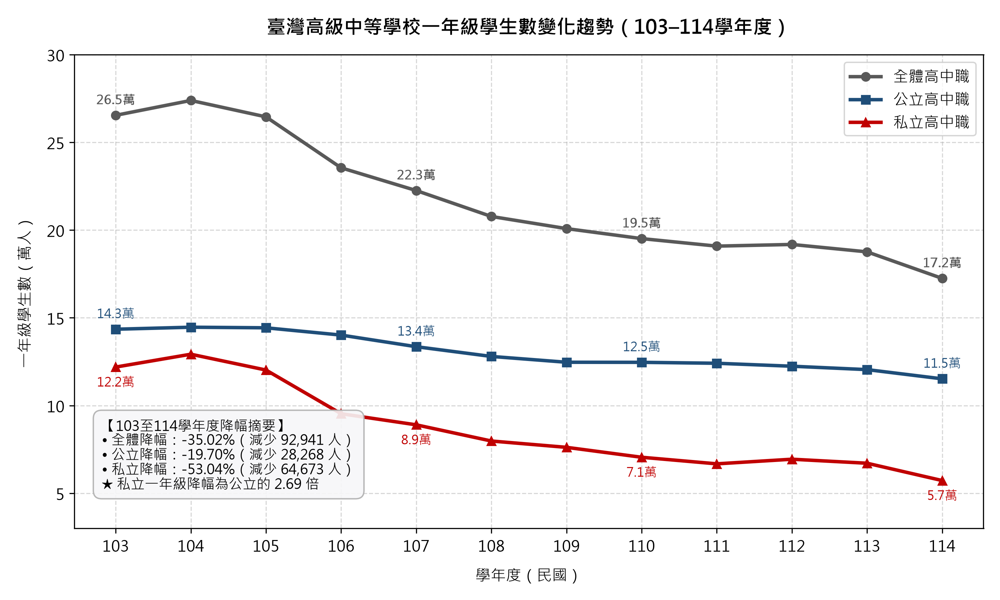
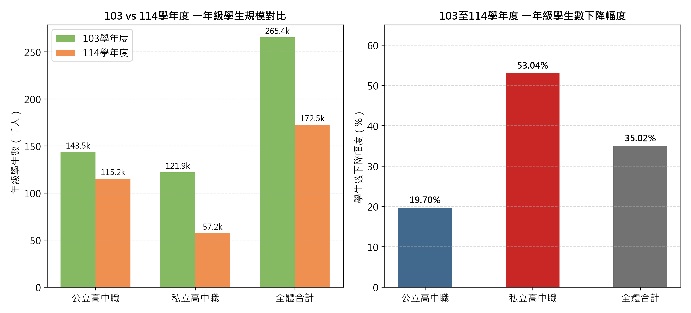
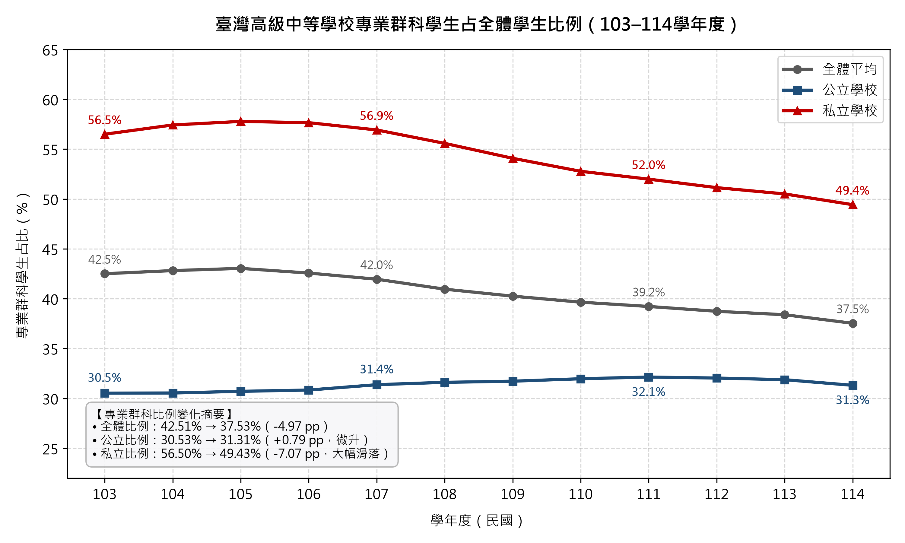
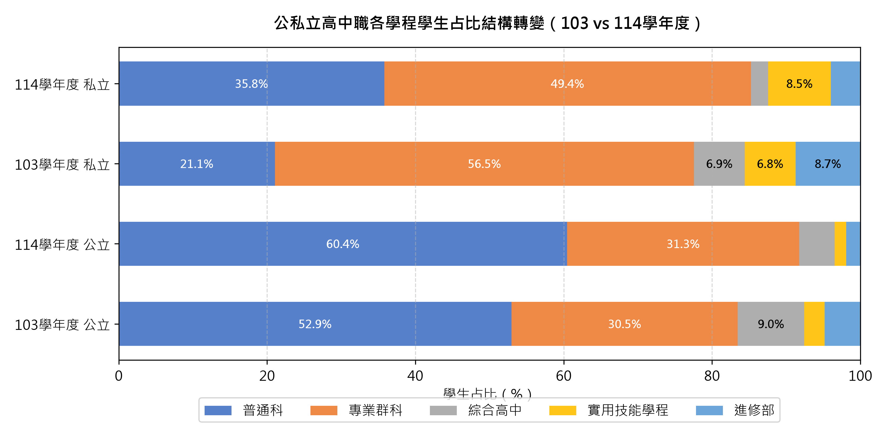

# 摘要

面對少子化浪潮，本研究探討民國 103 至 114 學年度臺灣高級中等學校公私立招生規模與專業群科占比之消長趨勢。利用教育部校級面板資料，排除進修、特教及矯正學校後，追蹤 6,142 筆校級年度紀錄。實證發現：第一，私立高中職一年級新生數劇降 53.04%（由 121,923 人銳減至 57,250 人），降幅為公立高中職（-19.70%）的 2.69 倍，私校承擔了近七成新生流失量；第二，全體專業群科學生占比自 42.51% 下降至 37.53%（-4.97 pp），且公私立呈現顯著分流——公立高職微幅提升 0.79 pp，私立高職則劇跌 7.07 pp，私立學校普通科占比反增 14.75 pp。研究顯示，生源縮減與技職萎縮之衝擊高度轉嫁至私立學校，呈現結構兩極化，政策應強化私立技職之轉型支持。

**關鍵詞**：少子化、高級中等學校、公私立差距、專業群科、學校面板資料

---

# 一、 前言

## （一） 研究背景

自民國 100 年代以降，臺灣面臨急遽之人口少子化浪潮，各教育階段學齡人口規模呈現不可逆的緊縮趨勢。高級中等教育作為銜接國民義務教育與高等教育之關鍵分流階段，其招生規模與學生選讀結構首當其衝承受人口結構轉型之全面衝擊。在國中畢業生人數逐年銳減的現實下，高級中等學校面臨空前的生源縮編、班級整併乃至退場危機。

面對人口減少所帶來的教育規模緊縮，學校體系的重組與招生市場的重構並非臺灣所獨有。國際實證研究亦指出，生育率下降與人口老化正對全球各國中等與基礎教育體系造成龐大整併與縮減壓力 [@hannum2022]。然而，在既有學校設立體制與學制分流之架構下，生源緊縮的衝擊是否在公私立學校之間平均分攤？又是否對普通高中與技術型高中（高職）造成不同程度的結構性消長？此一議題攸關教育資源配置的公平性與國家產業技術人力的培育基盤，實有必要運用長期縱向資料進行實證檢視。

## （二） 前人研究與理論預測

針對少子化對高級中等學校之影響，國內學者與教育決策當局早在制度變遷初期便提出理論預測與情勢警示。

在公私立學校的生源衝擊差異方面，郭義汶與吳清山 [@guo2017] 運用教育部歷年統計資料進行趨勢分析，指出少子化對公立與私立高級中等學校之影響存在嚴重的「不對稱性」：公立學校受惠於政府財政編列保障、收費低廉且社會品牌聲望較高，預期招生規模相對穩定；相對而言，私立學校因營運高度仰賴學雜費收入，在生源母數萎縮且學生選校往往以公立為第一志願的競爭情境下，預期將首當其衝承受招生缺口擴大與營運退場的巨大壓力。黃貴雄 [@huang2005] 的實證調查亦指出，臺灣私立高中職在招生機制與資源籌措上面臨先天結構性劣勢，生源緊縮將使弱勢私校迅速邊緣化。

在學程結構與技職教育變遷方面，周愚文 [@chou2024] 評析十二年國民基本教育實施後的教育體系演變，指出在免試入學與超額比序制度推動下，普通高中逐漸成為多數學生與家長的首選主流，技術型高級中等學校（高職）在升學主義氛圍下生源持續萎縮。教育部統計處 [@moe2018brief] 之官方統計簡訊亦證實，自 97 至 106 學年度期間，全國學生選讀普通科的比例呈現逐年上升態勢，而專業群科的選讀比例則持續下滑。近年來，技職體系學生急遽流失的現象更引發社會高度關注，數據顯示近年專業群科學生人數減少逾五萬人，其降幅顯著大於普通科 [@cna2025]。

儘管前人研究指出了少子化下公私立分流與技職萎縮的總體趨勢，但多數研究受限於斷面資料或短期觀察，缺乏涵蓋完整 103 至 114 學年度、結合校級追蹤之微觀實證數據；特別是公立與私立學校在「一年級新生規模縮減幅度」上究竟存在多大落差？以及專業群科占比的下滑究竟是由公立還是私立高職所主導？仍缺乏精確之面板資料實證支持。

## （三） 研究問題

基於上述背景脈絡與前人研究之理論預測，本研究利用教育部 103 至 114 學年度之校級面板資料 [@moe2025stats]，聚焦探討以下兩大核心研究問題：

1. **研究問題 1**：民國 103 到 114 學年度期間，私立高中一年級學生數（新生規模）的下降幅度，是否大於公立高中？兩者之萎縮速度與學生流失承擔比率存在何種實證落差？
2. **研究問題 2**：在同一分析期間內，專業群科（高職職業類科）學生占全體高級中等學校學生的比例是上升還是下降？公立學校與私立學校在專業群科占比的歷年變動方向與幅度上是否呈現分流？

---

# 二、 資料與方法

## （一） 資料來源與分析範疇

本研究分析資料取自教育部統計處釋出之高級中等學校公開統計資料庫 [@moe2025stats]，並使用臺灣高級中等學校校級面板資料集（`hs_school_year.csv`）。該資料集以學校為觀測單位，整合每學年度 9 月底統計基準日之校別規模、師資配置、班級數及各等級學程學生人數。研究分析期間涵蓋民國 103 學年度至 114 學年度（西元 2014 年至 2025 年），時間跨度共計 12 個學年度，原始母體包含 6,297 筆校級年度觀測值。

## （二） 樣本篩選標準與排除條件

為使研究樣本能精確反映一般常態日間高級中等學校之升學市場生態與學生流向，本研究依據資料字典之屬性欄位，設定以下三項排除條件：

1. **排除進修學校（111 筆）**：依據欄位 `continuing_school == True`（校名包含「進修」或「進校」者）。進修學校性質屬於成人補習教育與在職進修回流機制，其入學資格、修業年限與學生年齡結構均與日間常態學齡青少年不同，故予排除。
2. **排除特殊教育學校（16 筆）**：依據欄位 `special_education_school == True`（校名包含「啟明」、「啟聰」、「啟智」或「特殊教育」者）。特殊教育學校之設校宗旨在於安置身心障礙學生，班級人數與師資比嚴格受《特殊教育法》規範，招生採鑑定安置分發，不參與常態高中職選校競爭市場，故予排除。
3. **排除矯正學校（28 筆）**：依據設立別欄位 `sector == "correctional"`（如明陽中學、誠正中學等）。此類學校隸屬於法務部矯正署，專收容受感化教育或司法處分之少年，屬封閉式司法感化體系，非屬自由開放招生之中等教育機構，故予排除。

經上述條件排除後，共計剔除 155 筆觀測值，最終納入正式分析之有效樣本為 **6,142 筆校級年度紀錄**。

此外，資料中包含 40 筆學生總數為 0 之紀錄（`no_enrolled_students == True`），主要反映學校停招或處於退場過渡階段。由於此類學校在加總學生規模時其值自然為 0，且保留此類記錄能真實呈現歷年實體運作校數之縮減過程，因此本研究在統計學生總量時保留此類學校，並於統計校數變遷時作為退場歷程之觀察依據。

## （三） 學校公私立分類依據

本研究依據教育部學校代碼第 3 碼推導之設立別欄位（`sector`），將納入分析之 6,142 筆學校紀錄歸併為「公立」與「私立」兩大類：

1. **公立學校（3,694 筆）**：合併國立學校（`public_national`，共 1,758 筆）與直轄市及縣市立學校（`public_local`，共 1,936 筆）。國立與公立學校營運經費皆由政府財政全額或大宗支應，享有相同之公立收費體系與政策補助優勢。此外，103 至 114 學年度期間適逢桃園市升格直轄市及教育部轄管移轉，多所國立高中職相繼改隸為市立高中職（學校代碼隨之變更）。將國立與市立合併為「公立學校」，可消除行政體系移轉對校級時間序列所造成的斷層，維持縱向分析之一致性。
2. **私立學校（2,448 筆）**：包含所有私立高級中等學校（`private`）。私立學校由民間興辦，財務自負盈虧，營運仰賴學雜費與招生補助，對少子化引發之生源波動具有直接的敏感度。

## （四） 變數定義與統計指標計算

為回答本研究之兩大核心研究問題，分別定義相關變數與計算公式：

### 1. 研究問題 1：一年級學生數規模與降幅

- **變數定義**：以 `students_grade1` 代表各校在當學年度 9 月底之一年級學生總數（不含附設國中部），作為衡量當學年度新生入學規模之代理變數。
- **指標計算**：
  - **增減人數**：$\Delta N = N_{114} - N_{103}$，其中 $N_{103}$ 與 $N_{114}$ 分別為 103 學年度與 114 學年度之一年級學生人數。
  - **下降幅度（降幅百分比）**：
    $$\text{Drop Rate} = \left( 1 - \frac{N_{114}}{N_{103}} \right) \times 100\%$$
  - **年增率（YoY）**：$\text{YoY}_t = \frac{N_t - N_{t-1}}{N_{t-1}} \times 100\%$，用於觀察各年度新生人數之動態變動幅度。

### 2. 研究問題 2：專業群科學生占比與學程結構變動

- **變數定義**：
  - 專業群科學生數（`students_vocational`）：指各校等級別為「專業群科」（科別資料等級代碼 B，即高職職業類科）之學生人數。
  - 全體學生總數（`student_total`）：指各校該學年度所有等級學程（含普通科、專業群科、綜合高中、實用技能學程及進修部）學生數總和（不含附設國中部）。
- **指標計算**：
  - **專業群科學生比例（占比）**：
    $$\text{Ratio}_{\text{voc}, t} = \frac{\sum \text{students\_vocational}_t}{\sum \text{student\_total}_t} \times 100\%$$
  - **百分點變動量（pp）**：
    $$\Delta \text{pp} = \text{Ratio}_{\text{voc}, 114} - \text{Ratio}_{\text{voc}, 103}$$
  - **學程結構占比**：進一步計算普通科（`students_general`）、專業群科（`students_vocational`）、綜合高中（`students_comprehensive`）、實用技能學程（`students_practical_skills`）與進修部（`students_continuing_dept`）占全體學生總數之百分比，用以釐清高級中等教育總體內部之學制結構消長。

---

# 三、 研究結果

## （一） 一年級學生數變動趨勢與公私立降幅比較

### 1. 新生人數規模與降幅對比

在 103 至 114 學年度期間，臺灣高級中等學校一年級學生總數呈現大幅萎縮。如表 1 與圖 1 所示，全體高級中等學校一年級學生人數自 103 學年度的 265,415 人縮減至 114 學年度的 172,474 人，減少 92,941 人，總體降幅為 35.02%。

分析公立與私立學校之變動幅度，兩者呈現顯著落差（見圖 2）：

- **公立高中職**：一年級學生數自 103 學年度的 143,492 人下降至 114 學年度的 115,224 人，共計減少 28,268 人，下降幅度為 **19.70%**（約兩成）。
- **私立高中職**：一年級學生數自 103 學年度的 121,923 人銳減至 114 學年度的 57,250 人，共計減少 64,673 人，下降幅度達 **53.04%**（減少超過一半）。

數據顯示，**私立高中一年級學生數的下降幅度（53.04%）顯著大於公立高中（19.70%），私校降幅為公立學校之 2.69 倍**。在全體流失之 92,941 名一年級學生中，私立學校承擔了 69.59% 的人數減量。

| 設立類別 | 103學年度新生數（人） | 114學年度新生數（人） | 差額（人） | 變動率（%） | 下降幅度（%） |
| :--- | :---: | :---: | :---: | :---: | :---: |
| **公立高中職** | 143,492 | 115,224 | -28,268 | -19.70% | **19.70%** |
| **私立高中職** | 121,923 | 57,250 | -64,673 | -53.04% | **53.04%** |
| **全體合計** | 265,415 | 172,474 | -92,941 | -35.02% | **35.02%** |

*表 1：103 與 114 學年度公私立高級中等學校一年級學生數統計比較表*

{width=85%}

{width=85%}

### 2. 歷年動態走勢與學校數消長

檢視 103 至 114 學年度之逐年變動歷程（見表 2 與圖 1）：
1. 104 學年度全體一年級學生數曾微幅上升至 273,892 人（公立成長 0.80%、私立成長 6.01%）。
2. 自 105 學年度起學生數轉為連續衰退，其中 106 學年度出現最大幅度下挫，全體一年級學生單年減少 10.98%，該學年度私立高中一年級人數單年劇減 20.71%（由 120,232 人滑落至 95,333 人），公立人數則減少 2.88%。
3. 此後各學年度公立學校新生規模維持在 11.5 萬至 13.3 萬人之間緩步下降，年變動率介於 -0.04% 至 -4.73% 之間；私立學校新生規模則持續自 106 學年度的 9.5 萬人逐年跌至 114 學年度的 57,250 人。

| 學年度 | 公立一年級數 | 公立年增率 | 私立一年級數 | 私立年增率 | 全體一年級數 | 全體年增率 |
| :---: | :---: | :---: | :---: | :---: | :---: | :---: |
| 103 | 143,492 | - | 121,923 | - | 265,415 | - |
| 104 | 144,643 | +0.80% | 129,249 | +6.01% | 273,892 | +3.19% |
| 105 | 144,307 | -0.23% | 120,232 | -6.98% | 264,539 | -3.41% |
| 106 | 140,158 | -2.88% | 95,333 | -20.71% | 235,491 | -10.98% |
| 107 | 133,531 | -4.73% | 89,005 | -6.64% | 222,536 | -5.50% |
| 108 | 127,985 | -4.15% | 79,777 | -10.37% | 207,762 | -6.64% |
| 109 | 124,672 | -2.59% | 76,174 | -4.52% | 200,846 | -3.33% |
| 110 | 124,627 | -0.04% | 70,516 | -7.43% | 195,143 | -2.84% |
| 111 | 124,091 | -0.43% | 66,770 | -5.31% | 190,861 | -2.19% |
| 112 | 122,408 | -1.36% | 69,400 | +3.94% | 191,808 | +0.50% |
| 113 | 120,477 | -1.58% | 67,116 | -3.29% | 187,593 | -2.20% |
| 114 | 115,224 | -4.36% | 57,250 | -14.70% | 172,474 | -8.06% |

*表 2：103 至 114 學年度一年級學生數逐年統計表（含年增率 YoY）*

在學校數量方面，公立學校總數由 103 學年度之 295 所微幅增加至 114 學年度之 312 所；私立學校總數則由 103 學年度之 208 所減至 114 學年度之 199 所。私立學校之平均校均新生人數由 103 學年度之 586 人降至 114 學年度之 288 人，降幅達 50.85%。

## （二） 專業群科學生占比之走勢與公私立分流

### 1. 專業群科學生占比總體走勢

在學生群科結構方面，如表 3 與圖 3 所示，全體高級中等學校學生總數自 103 學年度的 813,870 人減少至 114 學年度的 528,941 人。其中，專業群科學生數自 345,937 人下降至 198,536 人，共減少 147,401 人，人數減幅為 42.61%。

**全體專業群科學生占全體學生之比例，自 103 學年度的 42.51% 下降至 114 學年度的 37.53%，整體下滑 4.97 個百分點（pp）**。

| 設立類別 | 103學年度比例 | 114學年度比例 | 百分點變動（pp） | 103學年度群科人數 | 114學年度群科人數 | 人數減幅（%） |
| :--- | :---: | :---: | :---: | :---: | :---: | :---: |
| **公立學校** | 30.53% | 31.31% | **+0.79 pp** | 133,855 | 108,745 | -18.76% |
| **私立學校** | 56.50% | 49.43% | **-7.07 pp** | 212,082 | 89,791 | -57.66% |
| **全體合計** | 42.51% | 37.53% | **-4.97 pp** | 345,937 | 198,536 | -42.61% |

*表 3：103 與 114 學年度專業群科學生數與占比統計比較表*

{width=85%}

### 2. 公立與私立學校專業群科占比之分流趨勢

將公立與私立學校分開檢視，兩者在專業群科比例之變化方向與幅度呈現明顯對比（見圖 3 與表 4）：

- **公立學校微幅上升**：公立專業群科學生數由 103 學年度之 133,855 人減少至 114 學年度之 108,745 人（減少 25,110 人，減幅 18.76%）；在此期間公立學生總數亦由 438,490 人減少至 347,291 人（減幅 20.80%）。因總體學生數縮減幅度略大於專業群科，使**公立學校專業群科學生占比自 103 學年度之 30.53% 微幅提升至 114 學年度之 31.31%，增加了 0.79 個百分點**。
- **私立學校大幅滑落**：私立專業群科學生數由 103 學年度之 212,082 人降至 114 學年度之 89,791 人，減少 122,291 人，減幅達 **57.66%**；同期間私立學生總數由 375,380 人減至 181,650 人（減幅 51.61%）。**私立學校專業群科學生占比自 103 學年度之 56.50% 下降至 114 學年度之 49.43%，大幅滑落 7.07 個百分點**，跌破五成水準。

數據顯示，**全體專業群科比例之下滑（-4.97 pp），其變動主要來自私立學校專業群科之劇烈縮減**；公立學校專業群科之比重則保持相對穩定並微幅提高。

| 學年度 | 公立群科數 | 公立總學生 | 公立占比 | 私立群科數 | 私立總學生 | 私立占比 | 全體群科數 | 全體總學生 | 全體占比 |
| :---: | :---: | :---: | :---: | :---: | :---: | :---: | :---: | :---: | :---: |
| 103 | 133,855 | 438,490 | 30.53% | 212,082 | 375,380 | 56.50% | 345,937 | 813,870 | 42.51% |
| 104 | 130,717 | 428,017 | 30.54% | 206,637 | 359,842 | 57.42% | 337,354 | 787,859 | 42.82% |
| 105 | 129,068 | 420,285 | 30.71% | 203,116 | 351,518 | 57.78% | 332,184 | 771,803 | 43.04% |
| 106 | 128,586 | 416,979 | 30.84% | 187,063 | 324,451 | 57.66% | 315,649 | 741,430 | 42.57% |
| 107 | 127,401 | 406,070 | 31.37% | 163,368 | 286,979 | 56.93% | 290,769 | 693,049 | 41.96% |
| 108 | 123,274 | 389,961 | 31.61% | 138,486 | 249,162 | 55.58% | 261,760 | 639,123 | 40.96% |
| 109 | 118,890 | 374,765 | 31.72% | 125,072 | 231,258 | 54.08% | 243,962 | 606,023 | 40.26% |
| 110 | 117,395 | 367,202 | 31.97% | 113,395 | 214,855 | 52.78% | 230,790 | 582,057 | 39.65% |
| 111 | 116,771 | 363,319 | 32.14% | 104,753 | 201,485 | 51.99% | 221,524 | 564,804 | 39.22% |
| 112 | 115,167 | 359,441 | 32.04% | 99,228 | 194,032 | 51.14% | 214,395 | 553,473 | 38.74% |
| 113 | 113,331 | 355,533 | 31.88% | 96,571 | 191,196 | 50.51% | 209,902 | 546,729 | 38.39% |
| 114 | 108,745 | 347,291 | 31.31% | 89,791 | 181,650 | 49.43% | 198,536 | 528,941 | 37.53% |

*表 4：103 至 114 學年度專業群科學生人數與占比逐年變化表*

### 3. 五大學程結構分布之轉變

進一步分析公私立高級中等學校各學程學生結構占比之消長（見表 5 與圖 4）：

- **公立學校學程結構**：普通科學生人數由 232,170 人降至 209,932 人，占公立總學生數之比重由 52.95% 上升至 60.45%（提升 7.50 個百分點）；專業群科占比由 30.53% 微升至 31.31%（提升 0.79 個百分點）；綜合高中學生人數由 39,251 人降至 16,605 人，占比由 8.95% 降至 4.78%（減少 4.17 個百分點）；實用技能學程占比由 2.75% 降至 1.54%；進修部占比由 4.82% 降至 1.92%。
- **私立學校學程結構**：普通科學生數由 79,043 人降至 65,041 人，但其占私立總學生數之比重自 21.06% 大幅攀升至 35.81%（增加 14.75 個百分點）；專業群科占比則自 56.50% 下降至 49.43%（減少 7.07 個百分點）；綜合高中占比自 6.87% 降至 2.32%；進修部占比由 8.75% 降至 3.98%；實用技能學程占比則由 6.83% 微升至 8.47%。

| 學制與設立別 | 103學年度學生數 | 114學年度學生數 | 103學年度占比 | 114學年度占比 | 占比變動（pp） |
| :--- | :---: | :---: | :---: | :---: | :---: |
| **【公立學校】** | | | | | |
| 普通科 | 232,170 | 209,932 | 52.95% | 60.45% | +7.50 pp |
| 專業群科 | 133,855 | 108,745 | 30.53% | 31.31% | +0.79 pp |
| 綜合高中 | 39,251 | 16,605 | 8.95% | 4.78% | -4.17 pp |
| 實用技能學程 | 12,079 | 5,350 | 2.75% | 1.54% | -1.21 pp |
| 進修部 | 21,135 | 6,659 | 4.82% | 1.92% | -2.90 pp |
| **公立合計** | **438,490** | **347,291** | **100.00%** | **100.00%** | - |
| **【私立學校】** | | | | | |
| 普通科 | 79,043 | 65,041 | 21.06% | 35.81% | +14.75 pp |
| 專業群科 | 212,082 | 89,791 | 56.50% | 49.43% | -7.07 pp |
| 綜合高中 | 25,791 | 4,218 | 6.87% | 2.32% | -4.55 pp |
| 實用技能學程 | 25,623 | 15,378 | 6.83% | 8.47% | +1.64 pp |
| 進修部 | 32,841 | 7,222 | 8.75% | 3.98% | -4.77 pp |
| **私立合計** | **375,380** | **181,650** | **100.00%** | **100.00%** | - |

*表 5：公私立高級中等學校各學程學生結構消長對比表（103 vs 114 學年度）*

{width=85%}

---

# 四、 討論與結論

## （一） 研究結果與前人研究之對照與詮釋

### 1. 私立高中職新生崩跌與公私立衝擊之不對稱性

本研究實證結果顯示，在 103 至 114 學年度期間，私立高中一年級新生數減少達 53.04%（人數腰斬），而公立高中一年級新生數僅減少 19.70%（約兩成）；私立學校之降幅為公立學校之 2.69 倍，且承擔了全體高中職近七成（69.59%）的新生流失量。

這項實證發現高度契合郭義汶與吳清山 [@guo2017] 早期運用政府教育統計所提出的理論預測。郭義汶與吳清山 [@guo2017] 指出，少子化對不同設立別學校之衝擊呈現顯著的不對稱性，公立學校因受政府財政編列與公帑支持，招生具備相對穩定性；反之，私立學校在學齡人口退潮的市場競爭中，必然首當其衝承受嚴重的生源缺口與招生震盪。本研究長達 12 個學年度的追蹤數據，具體驗證了此項理論預測的真實歷程。

此外，該結果亦深化了黃貴雄 [@huang2005] 針對私立中等學校招生困境的研究論點。黃貴雄 [@huang2005] 指出，私立學校因財務結構高度依賴學雜費、社會聲望及資源條件多居於劣勢，在學生志願選填體系中常處於後段順位。從選校排序機制的視角來看 [@klein2020]，當總體生源大幅萎縮而公立學校招生名額並未等比例劇烈縮減時，多數學生優先填報公立學校並獲得錄取，導致原本應外溢至私立學校的生源被大量抽離，使得少子化引發的生源萎縮幾乎完全由私立學校單方面吸收。

### 2. 專業群科占比走勢與公私立體系之極端分流

在學程結構方面，全體專業群科（高職職業類科）學生占全體高級中等學校學生之比例由 103 學年度的 42.51% 滑落至 114 學年度的 37.53%，整體下降 4.97 個百分點。這項總體下降趨勢支持了周愚文 [@chou2024] 評析十二年國教實施後普通高中擴張成為主流、技職體系逐漸萎縮的制度觀察，亦呼應了教育部統計處 [@moe2018brief] 記錄普通科比重攀升、專業群科走低的長期歷史趨勢。

然而，本研究最重要的突破在於揭示了公立與私立學校在技職比重上之「分流（Divergence）」現象：
- **公立高職比重持穩微升**：公立專業群科學生占比並未萎縮，反而由 30.53% 微幅提升至 31.31%（+0.79 pp）。公立高職憑藉穩固之公立品牌優勢、政府實習設備補助與較低之收費門檻，在少子化環境下仍維持穩定的學生結構比重。
- **私立技職體系嚴重潰縮**：私立專業群科學生占比自 56.50% 驟降至 49.43%（-7.07 pp），其專業群科學生總數在 12 年間縮減達 57.66%（流失逾 12.2 萬人）。

這項數據對照中央社 [@cna2025] 報導技職教育近年學生流失逾五萬人、衝擊大於普通科的現實困境，提供了關鍵的結構性解釋：**全體技職教育規模之萎縮，幾乎全數由私立技術型高中所承擔**。進一步從各學程結構消長觀察，私立學校普通科占比自 21.06% 大幅暴增至 35.81%（增加 14.75 個百分點），反映私立學校為因應技術類科高昂之設施設備維護成本與生源不足，紛紛採取縮編或停招職業類科、轉型增設普通科升學班的避險因應策略。

### 3. 國際學校整併與人口縮編之經驗參照

臺灣高級中等學校面臨之公私立分流與生源緊縮，在國際比較教育脈絡中亦具備對照意義。Hannum、Liu 與 Wang [@hannum2022] 在分析人口出生率下降與學校整併（School Consolidation）政策時指出，人口變遷對教育體系的規模效應帶來巨大衝擊，教育當局常透過學校合併或關閉以因應生源縮減。臺灣私立學校由 103 學年度的 208 所減至 199 所，且私校平均校均新生人數由 586 人腰斬至 288 人，反映人口減少下私立中等學校體系正實質經歷國際文獻所探討之規模緊縮與退場重組歷程。

## （二） 研究限制

本研究在資料與方法上存在若干限制，讀者在詮釋本研究結論時應審慎考量：

1. **觀察性資料無法確立因果關係（只能看出變化、不能證明原因）**：
   本研究使用之教育部校級面板資料屬於觀察性行政統計，**僅能客觀呈現 103 至 114 學年度學生人數與學程比例之縱向變遷現象，無法直接證明現象背後的單一因果關聯**。文中「私立學校一年級學生數劇降」或「私立專業群科萎縮」等現象，**學理上推論可能與少子化趨勢有關**，但實務上亦高度交織了十二年國教免學費補助政策、各就學區免試入學分發計分機制、社會大眾對技職升學之價值觀變遷，以及勞動市場產業需求轉型等多重結構性因素。
2. **學校停招、整併與校數消長之干擾**：
   一年級學生數之變化不僅反映個別家長與學生選校偏好之需求側變動，亦受到教育行政主管機關核定招生名額、學校停招、停辦、改制或整併等供給側政策之直接影響。本研究分析期間，公立學校總數由 295 所微增至 312 所（主要為新設縣市立完全中學或分校獨立），而私立學校則由 208 所降至 199 所。公立校數之擴張與私立校數之退場，自然牽動整體核定名額與入學容量，學生總人數之變動實為「個別學校招生縮減」與「整體設校數消長」之複合結果。
3. **微觀科別與學生背景資料之缺乏**：
   本研究受限於校級面板彙整資料，未細究各專業群科內部（如機械群、電機電子群、商管群、餐旅群等）因產業薪資與就業前景不同所產生之結構異質性〔需引用〕；亦缺乏學生家庭社經地位、學業成就與選校志願序等個體層次微觀變項〔需引用〕，未能進一步檢視不同社經階層學生在公私立與學制分流中之流動軌跡。

## （三） 結論與建議

本研究利用 103 至 114 學年度臺灣高級中等學校校級面板資料，對少子化浪潮下公私立學校一年級招生規模與專業群科占比變遷進行實證分析，獲得以下兩大核心結論：

1. **私立高中一年級學生數之下降幅度（-53.04%）顯著且大幅高於公立高中（-19.70%）**，私立降幅為公立之 2.69 倍，少子化引發的新生人數流失有近七成由私立學校單方面吸收，公私立學校招生呈現嚴重的兩極化發展。
2. **全體專業群科學生占全體學生之比例呈現下滑走勢（自 42.51% 降至 37.53%），且公私立呈現極端分流**：公立高職專業群科占比維持穩健微升（+0.79 pp），而私立高職專業群科占比則急遽滑落（-7.07 pp），顯示整體技職教育規模之縮減主要集中於私立體系。

上述實證結果顯示，臺灣高級中等教育正面臨私立技職體系崩縮與普通升學導向強化的雙重結構轉型。教育決策主管機關在制定私立高級中等學校退場與轉型輔導政策時，應正視公私立承擔生源衝擊之不對稱性，並針對面臨存續危機但具備技術培育價值之私立技術類科提供差異化之扶助措施，以維繫國家基層技術人才之健全培育鏈。

---

# 參考文獻
